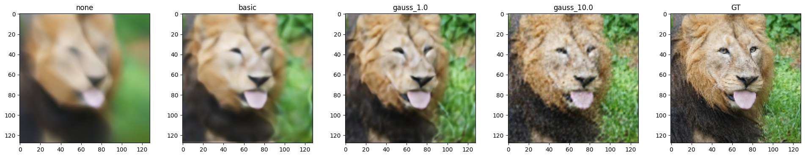
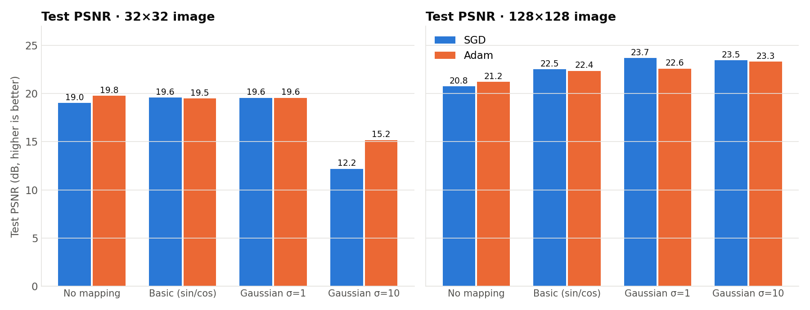
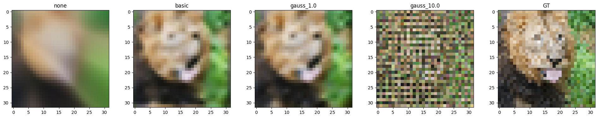
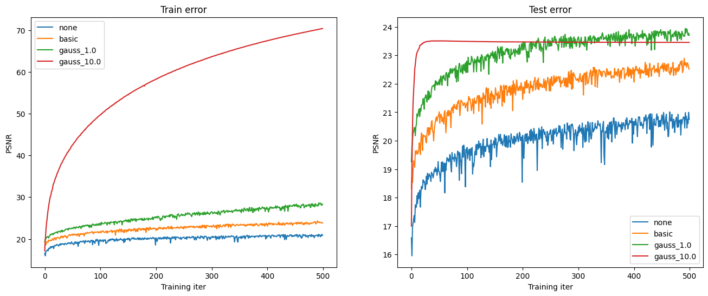
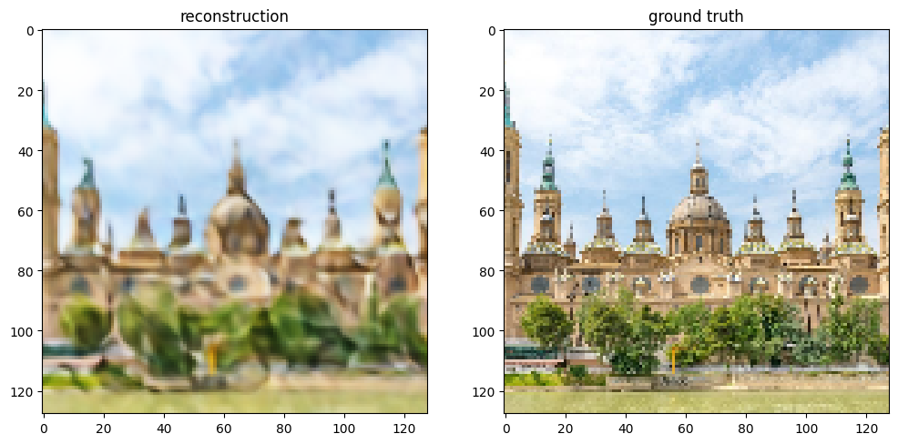
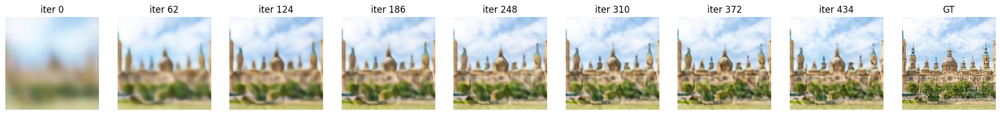

# Fourier Features for Neural Fields, in pure NumPy

**A multilayer perceptron written from scratch in NumPy (forward pass, backpropagation, SGD and Adam) that learns to represent an image as a continuous function `(x, y) → (r, g, b)`. It shows how Fourier feature mappings overcome the *spectral bias* of neural networks.**


<p align="center"><em>From left to right: raw coordinates, basic sin/cos mapping, Gaussian Fourier features (σ = 1, σ = 10), ground truth. All use the same network, the same 500 epochs and SGD.</em></p>

## The problem

Coordinate-based networks ("neural fields") are the building block behind NeRF and many 3D and graphics models. They take a coordinate and output a value at that point. Plain MLPs, however, have a **spectral bias**: they learn smooth, low-frequency functions easily and struggle with fine detail. Fed raw `(x, y)` coordinates, they produce blurry images.

Tancik et al. (NeurIPS 2020) showed that first mapping the input through random Fourier features, `γ(v) = [cos(2πBv), sin(2πBv)]`, lets the same MLP learn high-frequency detail. This project re-implements that experiment **without any deep-learning framework** and studies when it helps and when it fails.

## Results

The training set is the even rows and columns of the image; the test set is every pixel. Test PSNR (dB, higher is better):

| Input mapping | SGD 32×32 | SGD 128×128 | Adam 32×32 | Adam 128×128 |
|---|---|---|---|---|
| None, raw `(x, y)` | 19.01 | 20.75 | 19.76 | 21.21 |
| Basic `[cos 2πv, sin 2πv]` | 19.57 | 22.52 | 19.49 | 22.35 |
| Gaussian Fourier, σ = 1 | 19.56 | **23.70** | 19.55 | 22.59 |
| Gaussian Fourier, σ = 10 | 12.19 | 23.46 | 15.18 | **23.32** |



**Takeaways**

- **Fourier features fix spectral bias.** At 128×128, Gaussian features with σ = 1 gain about +3 dB over raw coordinates (23.70 vs 20.75 dB), and fur and grass texture appear that the plain MLP cannot produce.
- **Too much frequency causes aliasing.** At 32×32 the training grid is only 16×16 pixels. σ = 10 then injects frequencies above the grid's Nyquist limit, so the network memorizes the training pixels (train PSNR above 70 dB) but outputs a checkerboard in between them (12.19 dB test). At 128×128 the denser grid makes the same σ = 10 work (23.46 dB).
- **Adam is not a free win.** Implemented by hand with bias correction, Adam gives smoother training curves and clearly helps in the unstable aliasing case (+3 dB for σ = 10 at 32×32). For well-conditioned mappings it matches or slightly underperforms per-pixel SGD.

<table>
<tr>
<td width="50%"><br><em>32×32: σ = 10 aliases into a checkerboard.</em></td>
<td width="50%"><br><em>128×128: train (left) and test (right) PSNR per epoch.</em></td>
</tr>
</table>

### My own image: Basílica del Pilar (Zaragoza)

The method applied to a harder photo, with a uniform sky, detailed towers and foliage: **20.67 dB** test PSNR (σ = 1, SGD, 128×128). The sky is reconstructed well. Towers keep their shape but lose the tile texture. The foliage, which spans many spatial frequencies at once, comes out as color blobs. This shows the limits of a single global frequency scale.




## Implementation

`src/models/neural_net.py` is a fully-connected network written from first principles:

- **Layers:** 4 linear layers (3 hidden × 256 units) with ReLU, and a sigmoid output for RGB in [0, 1].
- **Forward and backward passes:** hand-derived gradients for the linear, ReLU and sigmoid layers and the MSE loss, caching activations during the forward pass for backprop. The sigmoid is numerically stable.
- **Gradient check:** analytic gradients match numerical finite differences to a relative error of about 10⁻⁸ or better (`notebooks/gradient_check.ipynb`).
- **Optimizers:** per-sample SGD (lr 0.1), and **Adam** (lr 1e-3, β₁ = 0.9, β₂ = 0.999) with first and second moment estimates and bias correction.
- **Input mappings:** none, basic, and Gaussian `B ~ N(0, σ²)` with σ ∈ {1, 10}. The image size sets the number of features.

```
(x, y) ─► γ(v) = [cos 2πBv, sin 2πBv] ─► Linear-256 ─► ReLU ─► Linear-256 ─► ReLU ─► Linear-256 ─► ReLU ─► Linear-3 ─► Sigmoid ─► (r, g, b)
```

## What I implemented

The course provided the notebook scaffold, the image loader, the plotting and video helpers, and the numerical gradient checker. I implemented the whole network (`neural_net.py`: layers, activations, loss, forward and backward passes, SGD and Adam), the Fourier feature mappings, the PSNR and MSE metrics, and the experiment runner. I also ran every experiment, including the custom-image study.

## Repository structure

```
├── src/
│   ├── models/neural_net.py         # NumPy MLP: forward, backprop, SGD, Adam
│   └── utils/gradient_check.py      # numerical gradient (course-provided)
├── notebooks/
│   ├── fourier_features.ipynb       # all experiments, with outputs
│   └── gradient_check.ipynb         # analytic vs numerical gradients
├── results/                         # figures, training videos (.mp4), psnr_log.json
├── assets/                          # network diagram and reference images
├── requirements.txt
└── LICENSE
```

## How to run

```bash
git clone https://github.com/PabloCarreras7/fourier-features-neural-fields.git
cd fourier-features-neural-fields
pip install -r requirements.txt
jupyter notebook notebooks/fourier_features.ipynb
```

Everything runs on a CPU, with no GPU and no deep-learning framework.

## Data

There is no dataset to download. The notebook fetches the test image from the [Fourier Features project page](https://bmild.github.io/fourfeat/) (`lion_orig.png`), and the custom-image section downloads a public photo of the Basílica del Pilar from the URL given in the notebook.

## What I learned

- Backpropagation with no autograd: deriving every gradient by hand and verifying it numerically.
- Spectral bias in practice, and why positional encodings (Fourier features, the encodings used in NeRF and transformers) are needed for neural fields.
- The link between the scale of the frequency mapping and the **Nyquist sampling limit**: the same σ that overfits at low resolution generalizes at high resolution.
- That an "advanced" optimizer is not universally better: Adam helped the badly-conditioned case and hurt the well-conditioned one.

## Acknowledgements and transparency

Part of this work comes from **CS 444: Deep Learning for Computer Vision at the University of Illinois Urbana-Champaign (Spring 2026)**. The scaffold and helper code are by the course staff. I used **Claude Code** as an AI assistant.

Reference: Tancik et al., *Fourier Features Let Networks Learn High Frequency Functions in Low Dimensional Domains*, NeurIPS 2020 · Rahaman et al., *On the Spectral Bias of Neural Networks*, ICML 2019.

## License

[MIT](LICENSE)
